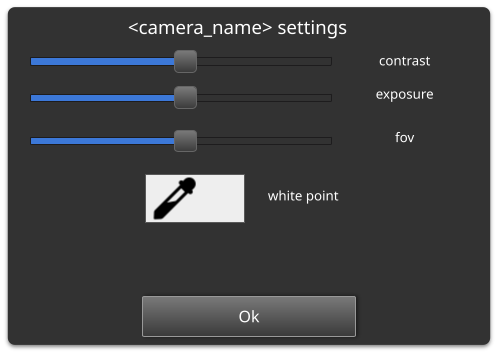
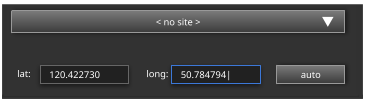
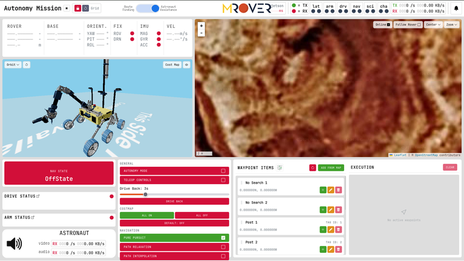

## 2026 - 2027 Projects

### Camera Client Changes

- **Ability to change camera settings (exposure, contrast, white-point, and FOV):** Add a button that opens a pop-up. This pop-up will contain prompts for changing the exposure, contrast, white-point, and FOV of individual cameras. A ROS service will be sent to the rover to change these through v4l2.

- **See the astronaut's video feed:** What it says on the tin. The astronaut's camera stream will be displayed with the rest of the cameras in the auton config.
- **Ability to move camera feeds between windows:** Currently, video feeds can only be moved *within* a window - they're fixed to a window as defined in yaml files. We are going to create a button that lets them be moved to an existing or new window.
- **Ability to screenshot all cameras at once:** Currently, only one camera can be screenshot at a time, despite us often needing multiple shots at the same location. A button to screenshot them all at once should be implemented.
- **Ability to tag camera images with site and coordinates:** During the science mission, science will visit two (or more) locations and record observations from them, including images from cams. Marking these images with a site and coords makes retrieving them easier. Coords can be entered either manually or derived from the rover's position, and the initial definition of a site can be defined in much same way. Future references to existing sites can be automatically assumed to be whatever is closest to the rover.

- **Notification for frozen cameras:** Camera streams from the rover to the basestation laptop are timestamped. These timestamps can be displayed in the camera client so the operator can quickly tell if a feed is still live.

### Auton GUI Changes

#### Astronaut Feed

- **Support two way audio-stream with the astronaut:** The auton GUI will have a (muteable) widget that plays the astronaut audio. Additionally, the operator can toggle the mic on the basestation laptop to speak with the astronaut.
- **See health of connection to the astronaut:** Similarly to our remote ROS (through websocket) interfaces, the astronaut widget will display the amount and speed of data being transmitted/received.
- **Drone Waypoints:** The drone operator will be able to select a spot in the environment (through the drone's cams) to put a waypoint. This waypoint will be transferred to the basestation where it should be visible on the map and in a list menu. 
- **Behavioral Tree Visualization:** The nav state will appear similar as it did last year. That is, until the operator interacts with it. Then, it will show the entire nav behavioral tree and the current stage of execution it is in.

### General

- **DEM Heatmap:** Digital elevation models (DEM) are available for the competition site. Our current satellite map lacks elevation data, and an elevation heatmap overlay will provide a quick way for the operator to gauge that.

## Spreadsheet

All current tasks should be accessible for members at [this spreadsheet](https://docs.google.com/spreadsheets/d/1YPRy4b-1OhNhXep2DHNy43zICfC72mdERJBsUHw-v0s/edit?usp=sharing).
